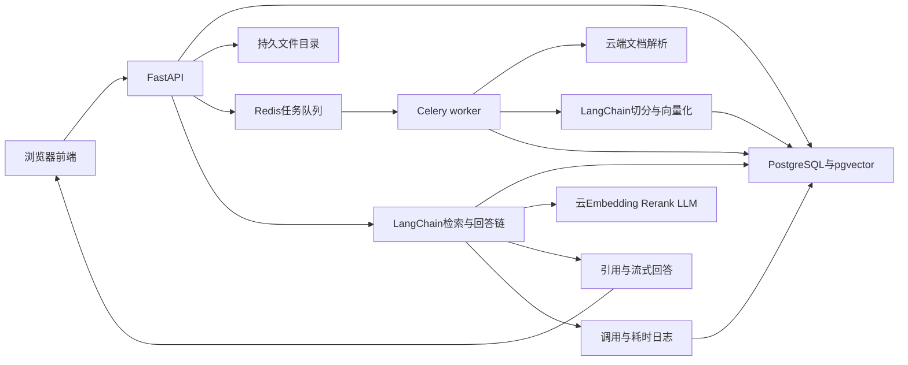

# 企业知识库中台 1.0：需求与技术方案

日期：2026-10-26。状态：方案 A 已确认；本机开发与验收；允许需要云端解析的原件发送至 DocMind。当前交付前端交互原型，原型确认后再进入真实服务联调。

本文记录已确认需求与技术方案。开发第一步是可点击前端原型；原型确认后再接入真实模型并进行样本文档验收。

## 1. 已确认的目标与边界

面向约 10 人的企业内部试用，完成“配置模型 → 创建知识库 → 导入资料 → 构建索引 → 检索测试 → 在线问答 → 查看日志”的完整闭环。

- 暂无登录。可以自由切换管理员、使用者、知识库管理人员。
- 知识库管理人员管理全部知识库。
- 后端知识处理与问答链路使用 LangChain。
- 导入 Word、PDF、Markdown、独立图片及 Excel/CSV 表格。
- PDF 包含电子文本、扫描页、图片中文字与表格；识别内容并保留来源页码，暂不理解趋势图、流程图、示意图含义。
- 表格支持查找记录、字段和规则，引用工作表/行号；暂不做求和、排名、跨表统计与公式重算。
- OCR 使用云端 API，无需本地下载或运行模型。
- 自行配置 OpenRouter、AIHubmix、通义的 LLM、Embedding、Rerank；三类能力可以混合选用不同供应商。
- 记录提问内容、Tokens、耗时，并支持排查失败原因。
- 每完成一个模块先自测、修复问题，再交付该模块结果。

角色选择是内部试用的功能入口切换。任何使用者均能切到管理员，因此不能据此限制真实人员的数据访问，也无法可靠把日志归属到具体员工。会话按匿名浏览器会话区分，管理员可以查看全量运行日志。

## 2. 建议的 1.0 功能

### 2.1 角色与入口

- 管理员：工作台、全部知识库、在线问答、模型服务、日志监测、基础设置。
- 知识库管理人员：全部知识库、导入任务、内容维护、检索测试、在线问答；查看相关构建任务状态和错误。
- 使用者：在线问答、可用知识库选择、当前浏览器的会话历史、答案来源阅读。

后台校验当前所选角色的操作范围，界面按角色提供入口；这一机制不构成身份认证。角色变化保留当前会话，但管理页面需重新校验入口。

### 2.2 模型服务

- 按供应商配置连接，按 LLM、Embedding、Rerank 分开选择模型、端点与参数。
- 支持新增、编辑、启停、设置默认值与真实连通性测试；手工填写模型 ID，模型列表可作为辅助。
- LLM 测试普通响应、流式响应和 usage；Embedding 测试数值、维度与批量限制；Rerank 测试相关度和结果索引。
- 密钥在服务端加密保存，主密钥由环境变量提供；前端仅显示掩码，不在日志、导出文件和浏览器持久存储中保存明文。
- 知识库固定绑定 Embedding 配置版本；LLM、Rerank 可调整，历史日志保留当次实际配置快照。
- 模型停用或删除前检查引用关系；正在使用的配置不能直接被破坏。
- OCR/文档解析独立配置，不把模型 API Key 当成文档解析凭证。

### 2.3 知识库与资料管理

- 创建、编辑、搜索、删除知识库；名称、说明、Embedding 模型、分段和检索设置。
- 文档列表显示类型、大小、更新时间、解析/索引状态、有效分段数和失败原因。
- 批量上传、重复文件识别、替换文档、重试失败任务、重建索引、删除资料。
- 查看解析内容、分段和来源；支持分段修订并重建对应索引，标记为人工修订，原文件作为独立来源版本保留。
- 检索测试展示候选片段、来源、检索/重排耗时和各类得分。得分不称为“答案置信度”，不同模型得分不能直接横比。
- 只检索已经完整发布的有效文档版本；单个失败文件不阻塞同批其他文件。

建议的具体格式为 `.docx/.doc`、`.pdf`、`.md`、`.png/.jpg/.jpeg`、`.xlsx/.xls/.csv`。旧版 Word 走云端解析；旧版 Excel 使用专用读取器。加密、损坏文件给出可恢复的错误；不执行宏、不运行表格公式。公式单元格读取已有缓存值，无缓存时说明无法获取计算结果。

来源定位遵循文件自身结构：PDF 使用真实页码；图片有可靠坐标时定位区域，否则定位到图片与文字片段；Word 优先标题和段落，云端生成页码标为解析页码；MD 为标题和行范围；Excel 为工作表及单元格/行范围，CSV 为行范围。不为没有固定分页的格式制造页码。

### 2.4 导入与构建流程

默认流程：选择知识库 → 上传并校验 → 云端解析/OCR或表格读取 → 预览内容与分段 → 确认构建 → 向量化 → 检索测试 → 用于对话。

状态明确区分：待上传、已上传、排队中、解析中、待确认、构建中、已就绪、失败、取消。显示当前阶段和实际数量；不知道进度时不显示虚构百分比。

预览阶段可调整分段设置。普通用户看到“每段长度、相邻段保留内容”等中文说明，高级区补充 Token 单位和检索参数。系统使用“构建索引”描述向量化，避免把它误称为模型训练。

建议初始限制：单文件 50 MB、PDF 200 页、单张图片 20 MB，每批 20 个文件。它们是应用默认保护值，可在实现时根据解析服务限制收紧；不是容量承诺。初步以不超过 1,000 份资料设计管理体验，真实页数和分段规模待导入基准测试后确定。

### 2.5 在线问答

- 选择一个或多个知识库，创建会话、切换历史会话、流式回答、停止生成、重试与复制。
- 连续追问时结合必要历史生成检索问题；保存原问题和实际检索问题，便于排查改写偏差。
- 根据所选 LLM 的上下文上限预留回答空间，控制历史与引用片段长度；必要时裁剪或压缩，无法满足时明确提示，避免超限请求。
- 回答下方显示引用，点击打开来源抽屉：文件名、版本、页码/工作表/行、命中片段及原文上下文。
- 人工修订内容的引用指向修订后的知识版本，并标记“人工修订”；原文件仅作为对照，不把修订文字高亮成原文件原文。
- PDF 支持跳转页码；有可靠坐标时高亮区域。坐标缺失时退回到页和片段定位，并明确表现。
- 空知识库、没有证据、资料冲突、部分知识库尚未就绪时有明确反馈。
- 默认只根据选中知识库作答，证据不足时说明未找到依据；不以模型常识补成企业制度。
- 文档内容作为待参考资料处理，不能覆盖系统指令；引用 ID 由后端校验，避免模型伪造不存在的来源。
- 历史回答保存当时引用快照。文档替换/删除后显示版本变化或已删除状态，新的问答不能再召回被删除版本。

### 2.6 日志监测

一次问答形成一条主记录，并关联各阶段调用明细：

- 时间、匿名会话、所选角色、原始问题、实际检索问题、选中知识库、回答状态、引用片段与配置版本。
- 供应商、模型、请求 ID、错误类别、重试次数、是否发生重排降级。
- 首字响应时间、总耗时、检索耗时、重排耗时、生成耗时。
- 输入/输出/总 Tokens，区分问题改写、查询 Embedding、Rerank、回答生成等调用。
- 导入过程的 Embedding 消耗单独统计；OCR 按页数/服务返回用量记录，重排如返回搜索单位则单列。
- 供应商未返回 usage 时显示“未返回”；估算时标明“估算”，不能把缺失或中途停止的用量记作 0。
- 支持时间、模型、知识库、状态筛选，问题搜索、明细查看与 CSV 导出；提供调用量、已报告 Tokens、耗时和错误率概览。

建议正文日志默认保留 30 天，可配置；清理正文后保留去除内容的汇总指标。因没有登录，本版不做按真实员工计费。费用不是必选项：只有供应商返回费用，或用户录入有效单价时才展示相应金额，并标明实际值或估算值。

## 3. 技术主方案 A：推荐

### 前端：React + TypeScript + Vite + Ant Design

选择原因：管理列表、表单、上传、步骤条、抽屉和日志筛选成熟，适合先交付可点击原型，再复用到正式应用。聊天和来源阅读区单独设计，统一浅色、留白、字级和状态文案。[Ant Design](https://ant.design/docs/react/introduce/)、[Vite](https://vite.dev/guide/)

优点：企业管理功能交付快、类型约束清晰、组件和可访问性基础较完善。代价：需要主动调整默认视觉，否则容易显得拥挤；前后端分开维护。

替代：React + Tailwind CSS + shadcn/ui，视觉定制自由，但复杂表格、导入和配置页面需要更多组合与维护工作。当前优先 Ant Design。

### 服务端：Python + FastAPI + LangChain

FastAPI 负责上传、任务、配置、会话和流式接口；Pydantic 做参数校验；SQLAlchemy/Alembic 管理数据库及变更。LangChain 组织文档、切分、检索、重排与生成链路。首版使用固定的 RAG 流程，调用路径可追踪，便于控制时延和消耗。[LangChain 检索架构](https://docs.langchain.com/oss/python/langchain/retrieval)

优点：Python 资料处理生态与 LangChain 衔接自然，接口定义和异步调用方便。代价：前后端两种语言，需维护模型适配与稳定依赖版本。最终版本在进入开发时锁定。

### 数据：PostgreSQL + pgvector

同一个 PostgreSQL 保存业务信息、任务、会话、日志、分段和向量。使用 pgvector 检索，LangChain 有官方集成。[pgvector 集成](https://docs.langchain.com/oss/python/integrations/vectorstores/pgvectorstore)

优点：组件少，文档有效版本、内容和向量可在同库事务中协调，适合 10 人起步。代价：需要做索引和查询调优，后续大规模检索可能需要独立服务。

中文关键词检索采用应用层 Jieba 分词，写入 PostgreSQL 全文索引；与向量召回做 RRF 融合，然后云端重排。该实现称为“中文关键词全文检索”，不称为 BM25。型号、合同号和英文缩写需要保留，入库与查询使用同样的归一化规则。[PostgreSQL 全文检索](https://www.postgresql.org/docs/current/textsearch-controls.html)、[Jieba](https://github.com/fxsjy/jieba)

向量模型连接测试必须记录实际维度。普通 pgvector HNSW 向量索引有 2,000 维限制，不能对所有模型直接套用；较高维模型按服务支持的维度设置或精确检索方案处理，并在配置测试中说明，禁止静默截断。更换模型即使维度相同也要重建。[pgvector 官方说明](https://github.com/pgvector/pgvector)

### 异步任务：Celery + Redis

文档解析、OCR、批量向量化和重建在独立 worker 中执行。Redis 开启持久化，任务状态与云端任务 ID 存在 PostgreSQL，支持查询、有限重试、恢复和对账补投。[FastAPI 后台任务建议](https://fastapi.tiangolo.com/tutorial/background-tasks/)、[Celery 任务语义](https://docs.celeryq.dev/en/stable/userguide/tasks.html)

优点：刷新网页或 API 重启不应丢失构建状态，长任务不占住请求。代价：多一个 Redis 服务及 worker；任务需按至少一次投递设计幂等，不能假设恰好执行一次。

### 文件与部署：持久目录 + Docker Compose

原文件、解析结果和预览文件保存在服务器持久目录，封装存储接口，未来可切换 OSS/S3。部署包含 Web、API、worker、PostgreSQL、Redis，API 和 worker 复用后端镜像。[Docker Compose](https://docs.docker.com/compose/intro/features-uses/)

优点：适合单机内部试用，少维护一个对象存储服务。代价：单机故障会中断使用，数据库和文件必须一致备份，不具备多机高可用。

建议先在本机完成原型与联调，再部署公司内网 Linux 服务器。开发验收起点可按 4 vCPU、8 GB 内存、足够的持久磁盘估算；无本地模型，无 GPU 要求。这是待验证的起步资源建议，实际容量和响应速度由资料量、云端限流、模型和测试结果决定。

## 4. 备选方案 B

前端和 Python 后端保持相同，把向量存储换成 Qdrant，业务数据仍放 PostgreSQL。向量检索可独立扩容，但会增加一个服务、双库同步和删除一致性处理。更适合后续资料规模明显增长、已有 Qdrant 运维基础的团队；当前 10 人试用优先 A。[Qdrant 集合说明](https://qdrant.tech/documentation/manage-data/collections/)

若更重视界面自由度，可仅替换前端组件方案，无需同时替换数据库。

## 5. 云端解析：建议 DocMind

Word、PDF、图片使用阿里云文档智能 DocMind 的文档解析 API；Markdown 与 Excel/CSV 直接读取结构，保留标题、工作表与行范围。这样既保留复杂 PDF 的版面信息，也不把 Excel 行号交给 OCR 猜测。

DocMind 采用“提交任务 → 查询状态 → 获取结果”的异步方式。详细 API 支持 Markdown 与 `visualLayoutInfo`，可以返回页面图片、布局坐标与页码；需要及时保存结果和引用资产。[DocMind 详细 API](https://help.aliyun.com/zh/document-mind/developer-reference/document-parsing-large-model-version)

优点：云端处理，无需本地模型，中文办公文档和扫描表格可用同一服务接入。代价：另行开通和按量计费，使用独立的 AccessKey/RAM 鉴权；百炼的模型 Key 不能替代它。只有需要云端解析的文件才发送原件；模型接收提问及必要检索片段，Embedding 服务接收待索引文本。

默认设置 `LlmEnhancement=false`，复杂扫描件质量不足时可单独启用云端增强。1.0 仅将文字和表格内容用于检索，不承诺图表趋势、流程或估值解释；不假设解析服务具有关闭所有图表处理的开关。DocMind 概览和详细接口对坐标能力的描述存在差异，最终以详细接口和真实样本返回为准；不把文档声明等同于已验收。备选是 LlamaParse 云解析，只有主服务对样本效果不达标时再比较，无需首版同时接两家。[LlamaParse 输出结构](https://developers.llamaindex.ai/llamaparse/parse/guides/response-format/)

## 6. 三家供应商接入核实

以下是 2026-10-26 官方文档中的能力，尚未使用用户账号进行付费调用。

### OpenRouter

LLM 为 `/api/v1/chat/completions`，Embedding 为 `/api/v1/embeddings`，Rerank 为 `/api/v1/rerank`。三类能力独立配置，按账号可用模型测试。[LLM](https://openrouter.ai/docs/api/api-reference/chat/send-chat-completion-request)、[Embedding](https://openrouter.ai/docs/api/api-reference/embeddings/submit-an-embedding-request)、[Rerank](https://openrouter.ai/docs/api/api-reference/rerank/submit-a-rerank-request)

### AIHubmix

LLM 为 `/v1/chat/completions`，Embedding 为 `/v1/embeddings`，Rerank 为 `/v1/rerank`。兼容接口和重排适配分别实现。[集成](https://docs.aihubmix.com/en/api/Jina-AI)、[Embedding](https://docs.aihubmix.com/cn/api/EBD)、[Rerank](https://docs.aihubmix.com/cn/api/Rerank)

### 通义/阿里云百炼

LLM 与 Embedding 使用对应地域及业务空间的兼容接口。当前重排文档的 `qwen3-rerank` 兼容路径是 `/compatible-api/v1/reranks`，也支持 DashScope 原生接口；不能由聊天接口地址机械拼接。配置中保存地域、业务空间和能力端点。[LLM](https://help.aliyun.com/zh/model-studio/stream)、[Embedding](https://help.aliyun.com/zh/model-studio/text-embedding-synchronous-api)、[Rerank](https://help.aliyun.com/zh/model-studio/rerank)

LangChain 层对 OpenRouter 对话优先采用专用集成，其他路径按能力包装。官方说明 `ChatOpenAI` 并不完整保留第三方扩展字段，所以本系统采用“供应商 × 能力”适配器。[ChatOpenRouter 官方参考](https://reference.langchain.com/python/langchain-openrouter/chat_models/ChatOpenRouter)、[ChatOpenAI 兼容范围](https://docs.langchain.com/oss/python/integrations/chat/openai)

不强制每家模型都具备相同参数。配置页区分流式、usage、向量维度和重排格式等能力；具体模型是否开通、余额和配额需要真实连接测试。

## 7. 关键工程规则

- 导入：任务记录先持久化，保存源文件校验值和解析任务 ID；查询云端任务失败时先恢复状态，避免重复提交导致重复计费。
- 更新：新版本内容和向量全部成功后再切换生效；重建失败仍保留旧版本可用。
- 删除：先排除检索，再清理资产；后台写回前检查删除标志与版本，避免资料“复活”。
- Embedding：模型、维度和配置版本与索引绑定；重建期间用旧模型查询旧索引，不混用向量空间。
- 重排：失败可回退到融合结果，界面和日志标记降级；不套用另一种得分的阈值。
- 多库：只查询所选库；Embedding 不同则分别编码和检索，再用适当融合/重排合并，不直接跨空间比较距离。
- 流式：记录正常完成、失败、停止、断线；停止前已经产生的消耗按真实 usage 记录，未知部分保留未知。
- 重试：限制次数和退避，区分无效 Key、配额不足、限流、超时与格式错误，不对所有错误无限重试。
- 备份：数据库与原文件/解析资产配套备份，验收一次恢复过程。

拟议链路如下，所有组件均属于待确认设计：

## 8. 第一阶段前端原型

参考 FastGPT 的工作区导航、内容列表、导入分步、配置与测试联动、答案引用阅读方式。采用自己的产品名称、文案和视觉，不依赖 FastGPT 源码实现。[FastGPT 官方流程](https://doc.fastgpt.cn/zh-CN/guide/getting-started/quick-start)、[引用阅读设计](https://doc.fastgpt.cn/zh-CN/guide/chat/quoteList)

原型包含以下完整页面与状态：

1. 工作台：角色切换、导入/问答入口、待处理任务和运行概览。
2. 知识库列表：搜索、新建、编辑、删除和可用状态。
3. 知识库详情：资料、导入任务、分段内容、检索测试、设置。
4. 导入向导：选文件、校验、解析状态、分段预览、确认构建、成功与失败重试。
5. 在线问答：知识库选择、会话历史、流式表现、停止、无证据、错误、来源抽屉。
6. 模型服务：三种供应商与三类模型配置、独立 OCR 配置、测试与引用状态。
7. 日志监测：筛选、查询、问答明细、阶段耗时、Tokens 和失败原因。

桌面优先，保证常见笔记本尺寸可用。全局固定导航，页面只保留一个主要操作；列表用表格承载任务状态，配置使用侧栏/抽屉；对话保持正文宽度和清晰的引用入口。状态统一采用“解析中、构建中、已就绪、失败”，不把上传完成误写成知识库可用。

原型使用明确标记的演示数据，不要求输入真实密钥。自测角色切换、完整操作路径、表单校验、空态、失败态、弹窗与来源阅读。你确认功能无误后，再进入真实后端开发。

## 9. 模块交付与验收

当前为阶段 0：调研与方案。后续严格按以下顺序推进：

1. 前端原型：全部页面和主流程可点击，自测通过，提交用户确认。
2. 基础服务与模型配置：数据库、持久存储、任务、三类模型/OCR适配；真实测试错误 Key、不可用模型、维度、流式及 usage。
3. 资料导入与构建：逐格式验证解析、来源、分段、重试、重复上传、更新和删除；重启 worker 后可恢复。
4. 检索与问答：关键词/语义召回、融合、重排、连续追问、引用、停止与无证据反馈。
5. 日志与整体交付：全过程消耗和耗时、筛选导出、10 人场景并发、备份恢复、部署说明。

每个模块产出功能、自测结果与未解决问题。先修复已发现缺陷，再推进依赖该模块的工作。模拟响应只能证明界面和契约，不能证明真实 OCR 或模型链路成功。

建议验收集：含电子页/扫描页/图片文字/跨页表格的 PDF、Word 与旧版 Word、Markdown、独立图片、Excel 多工作表、旧版 Excel、CSV；配套至少 20 个有标准来源的问题及 5 个资料外问题。测试集由通用样本起步，联调时补企业脱敏样本。

验收重点：

- 每种格式至少一个代表样本完整走通，来源定位正确；复杂表格另列样本结论。
- 替换/重建失败不影响旧有效版本；重复提交不产生重复有效内容；导入时删除不会复活。
- 三家 × 三类能力分别完成真实调用；仅对已提供并有权限的模型测试，未提供的账号记录为待验证。
- 资料内问题有可核对引用；资料外问题明确说明缺少依据；切换知识库不串库。
- 流式停止、重排失败、供应商限流和断线均有清楚状态与日志。
- 10 人使用规模下记录并发 1/5/10 的成功率和首字/总耗时；具体响应目标在选定模型、配额和测试资料后约定，不能用人数直接推导。
- 用量与供应商真实 usage 对账；未返回不记 0。
- 角色入口符合选定范围，匿名会话不会误显示另一浏览器的历史。

## 10. 待确认的决策

1. 是否选择主方案 A（React/Ant Design + FastAPI/LangChain + PostgreSQL/pgvector + Celery/Redis），以及 DocMind 云端解析？也可选择 B 或只调整前端。
2. 部署位置：建议本机开发与验收、公司内网服务器试用；服务器需能访问选定的模型和解析 API。请明确最终是本机、公司服务器还是云服务器。
3. 云端数据范围：请明确是否允许 Word/PDF/图片原件发往 DocMind，资料文本发往所选 Embedding，提问和必要检索片段发往所选 Rerank/LLM。若有限制，应列出允许的供应商和资料范围。

文档量、具体模型和样本无需现在逐项填写；先采用本文的暂定限制，真实集成时再配置与测试。真实联调使用你配置的服务；尚未提供可用凭证的能力明确标记待验证，不以模拟结果宣称全链路完成。
