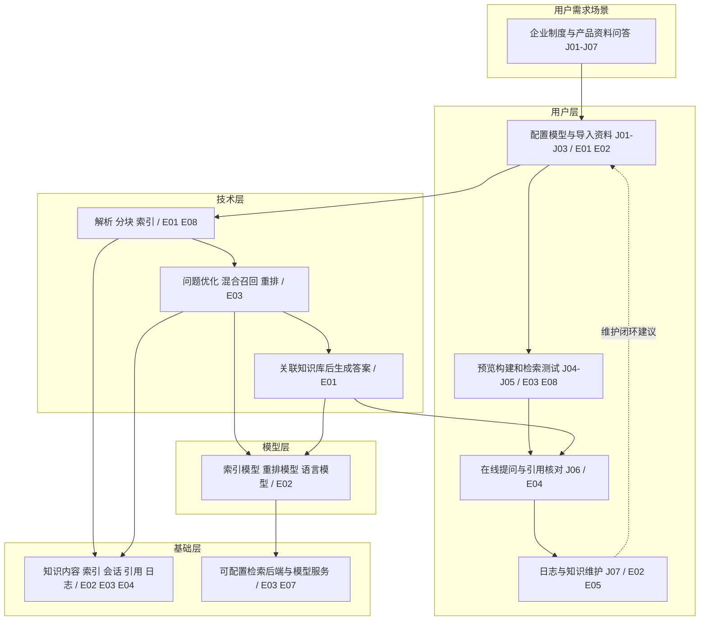

# FastGPT 功能调研与企业知识库 1.0 设计参考

调研日期：2026-10-26。产品主体：labring/FastGPT，Web 工作台、云服务与自部署版本。

## 范围与结论

本次完成官方文档、公开操作说明与发布记录核验，覆盖主要产品模块；不声称逐个 API 字段、工作流节点参数和商业配置均已实测。

工作台浏览工具两次访问超时，没有进入登录后的产品，也未上传文件或调用模型。下文的交互事实来自官方操作文档，截图只列为原始参考链接；未完成截图像素级审阅，未生成亲测截图、耗时或准确率评分。

版本基准：官方 GitHub 当前 Latest 是 **v4.17.2（2026-10-09）**；文档已有 **v4.17.3“进行中”**，不能把文档中新功能一律视为稳定版已发布。[正式发布](https://github.com/labring/FastGPT/releases/tag/v4.17.2)、[进行中版本](https://doc.fastgpt.io/zh-CN/self-host/upgrading/4-17/4173)

核心结论 C01：FastGPT 的功能范围已经覆盖 AI 应用平台。我们的第一版应选取知识导入、索引、检索问答和日志闭环；可视化编排、Agent、插件与企业集成分阶段扩展。该取舍是本项目建议，不是对 FastGPT 能力的删减描述。

## 一、用户需求场景

共同任务：知识库管理人员导入公司制度、产品说明及表格，员工通过自然语言提问，取得可核对来源的答案；管理员检查模型、消耗和失败原因。

定义贯穿后文的任务编号：J01 配置模型，J02 创建知识库，J03 导入解析，J04 预览并构建索引，J05 检索测试，J06 在线对话和查来源，J07 查看日志并维护资料。

已经明确确认：官方快速上手存在“知识库 + 对话 Agent”流程，以资料检索后回答为任务主线，并要求检查是否引用真实资料。证据性质为页面事实，来源子类型为官方披露，不代表亲测效果。[E01 快速上手](https://doc.fastgpt.cn/zh-CN/guide/getting-started/quick-start)

待确认核实：真实企业资料上的可读性、检索质量、响应时间和失败恢复效果；当前没有账号实操与样本结果，因此不打分。

对本项目的意义：知识管理人员需要能检查导入是否成功，员工需要能核对答案，管理员需要能定位问题。只交付聊天框不足以完成任务。

## 二、用户层：操作路径与布局参考

### 官方说明中的任务旅程

- J01：管理员模型提供商页面区分渠道和模型，提供各类模型测试。可以参考“配置后立即测试”的反馈方式。[E02 模型配置](https://doc.fastgpt.io/zh-CN/self-host/config/model/intro)
- J02–J04：知识库入口、新建、文件上传、参数设置、分块预览、等待就绪。可以提炼成连续步骤，并允许预览后回调参数。[E01 快速上手](https://doc.fastgpt.cn/zh-CN/guide/getting-started/quick-start)
- J05：检索测试应解释命中内容与搜索参数的影响，而不是只输出一段生成答案。[E03 检索方案](https://doc.fastgpt.io/zh-CN/guide/dataset/dataset_engine)
- J06：引用入口可打开原文、定位片段和切换不同引用；这比只展示文件名更方便核对。[E04 引用阅读器](https://doc.fastgpt.cn/zh-CN/guide/chat/quoteList)
- J07：区分模型调用与应用运行记录，避免混淆“模型调用成功”和“回答有用”。[E02 模型配置](https://doc.fastgpt.io/zh-CN/self-host/config/model/intro)、[E05 评测](https://doc.fastgpt.io/zh-CN/guide/build/evaluation)

以上为已经明确确认的官方流程说明，证据性质为页面事实/官方披露。真实点击体验、窄屏布局和异常恢复仍待实操核实。

### 本项目采用的设计原则

这些属于设计建议，不写成已观察到的 FastGPT 视觉细节：

- 全局导航保持稳定，库内用页签管理资料、任务、检索测试与设置。
- 新建与导入放在当前页面明确位置，减少跨页面找入口。
- 导入步骤先给普通设置，专业参数逐步展开，配中文说明。
- 配置与检索测试就近呈现，修改后能立刻验证。
- 对话正文与会话管理分栏，点击来源打开抽屉，保留阅读上下文。
- 同一状态用同一词语；“上传成功”和“已就绪”分别表现。
- 失败同时说明阶段、原因与恢复动作，例如“向量构建失败，请检查模型配置后重试”。

文案采用自己的名称与表达。“知识库/资料/知识片段/构建索引/检索测试/来源”作为主要用户术语；Embedding、Rerank、Token 只在模型与高级设置中出现解释。

官方图示原始参考：

- [应用配置与调试分栏](https://doc.fastgpt.cn/_next/static/media/image-02.8f3adca1.png)
- [知识库创建入口](https://doc.fastgpt.cn/_next/static/media/image-12.0332c2f1.png)
- [解析参数](https://doc.fastgpt.cn/_next/static/media/image-15.2096e2d8.png)
- [分块预览](https://doc.fastgpt.cn/_next/static/media/image-16.37bb8e45.png)
- [构建就绪状态](https://doc.fastgpt.cn/_next/static/media/image-17.5c3a7cc9.png)

这些是 E01 中的官方素材链接，未另存为本项目亲测截图。

## 三、技术层：功能版图与 1.0 取舍

以下 12 组覆盖主要产品能力，均区分 FastGPT 官方说明与本项目范围。各组功能存在性的确认性质是官方披露；未逐项亲测。具体商业归属统一在第 12 组后说明。

### 1. 知识组织和数据管理

FastGPT：知识库、集合/文件、分块数据分层，多库复用，内容和索引维护，API 访问。[数据结构](https://doc.fastgpt.io/zh-CN/guide/dataset/dataset_engine)、[知识库 API](https://doc.fastgpt.io/zh-CN/openapi/dataset)

本项目 1.0：库、文档、分段三级管理，搜索、编辑、替换、删除和重建。复杂目录、知识资产导出后续考虑。

### 2. 文件与知识导入

FastGPT：官方仓库列出多种办公文档、文本、网页、表格格式，另有手工输入、直接分段、AI 问答拆分与模板导入。[仓库功能清单](https://github.com/labring/FastGPT)、[模板导入](https://doc.fastgpt.io/zh-CN/guide/dataset/template)

本项目 1.0：按用户要求支持 Word、PDF、MD、图片、Excel/CSV，批量导入和查重。PPT、网页抓取、QA 模板不是本期必需。

模板导入与普通 Excel 解析要区分：FastGPT 模板对 `.xlsx`、表头和工作表有特殊约束，不能把模板限制套到所有表格解析场景。

### 3. 解析、OCR 和多模态

FastGPT：官方产品说明包含复杂 PDF、扫描件、图表、公式和 Markdown 结构化；实际能力取决于解析配置，图片知识库与文本解析不是同一项功能。[产品说明](https://doc.fastgpt.io/zh-CN/guide/getting-started/)、[解析问题排查](https://doc.fastgpt.io/zh-CN/guide/dataset/faq)

本项目 1.0：云端 OCR、图片文字与表格提取、来源定位和解析预览；不做图搜图、图片向量检索或图表含义推理。复杂样本效果待真实 API 验收。

### 4. 分块、索引与构建任务

FastGPT：分块参数、内容预览、增强索引和 QA 处理；v4.17.2 明确区分解析、索引中、索引完成，未就绪内容不召回。[分块参数](https://doc.fastgpt.io/zh-CN/openapi/dataset)、[v4.17.2 发布](https://github.com/labring/FastGPT/releases/tag/v4.17.2)

本项目 1.0：参数、预览、人工修订、明确状态、失败重试与版本发布。AI 自动扩写、自动生成问题索引后续做。

### 5. 检索、重排与检索测试

FastGPT：语义、全文和混合检索，融合、重排、引用长度控制与多轮问题优化；知识库搜索节点有模型与参数约束。[搜索方案](https://doc.fastgpt.io/zh-CN/guide/dataset/dataset_engine)、[搜索节点](https://doc.fastgpt.io/zh-CN/guide/build/workflow/nodes/dataset_search)

本项目 1.0：中文关键词 + 向量召回，融合后云端 Rerank，支持检索测试和多库选择。不同 Embedding 库分别检索后融合，禁止直接比较不同空间的向量距离。

### 6. 对话应用与引用

FastGPT：模型、Prompt、对话记忆、开场白、快捷问题、调试预览和引用阅读。[AI 设置](https://doc.fastgpt.io/zh-CN/guide/build/general/ai_settings)、[开场白](https://doc.fastgpt.io/zh-CN/guide/build/general/welcomeText)、[引用阅读器](https://doc.fastgpt.cn/zh-CN/guide/chat/quoteList)

本项目 1.0：固定知识问答入口、流式输出、历史会话、停止/重试、资料外答复、来源查看。多应用市场、语音、交互 HTML 后续考虑。

### 7. 可视化工作流

FastGPT：模型、知识检索、分类、提取、条件、变量、HTTP、代码、循环、并行、用户交互等节点及调试校验；自然语言辅助生成功能需结合版本状态判断。[工作流原理](https://doc.fastgpt.io/zh-CN/guide/build/workflow/intro)、[规则校验](https://doc.fastgpt.io/zh-CN/guide/build/workflow/rules)

本项目 1.0：实现可配置的固定链路，不开发流程画布。工作流编辑器作为后续独立模块评估。

### 8. Agent、工具、MCP、技能与插件

FastGPT：官方文档涉及工具调用、Agent V2、技能代码空间、插件安装及 MCP 发布；不能仅凭导航存在就判断所有能力已在稳定社区版发布。[Agent 调试](https://doc.fastgpt.io/zh-CN/guide/build/agentv2/debug)、[技能](https://doc.fastgpt.io/zh-CN/guide/build/skill/intro)、[插件](https://doc.fastgpt.io/zh-CN/plugin/intro)、[MCP](https://doc.fastgpt.io/zh-CN/guide/build/publish/mcp_server)

本项目 1.0：不纳入自主 Agent、沙盒执行、插件市场与技能 IDE；保留内部适配接口即可。

### 9. 模型管理

FastGPT：模型类型区分、供应商渠道、映射、启停、连接测试，以及模型运行管理。[模型配置](https://doc.fastgpt.io/zh-CN/self-host/config/model/intro)

本项目 1.0：三供应商 × LLM/Embedding/Rerank 分别配置和测试，独立解析服务，密钥保护与配置版本。负载均衡、自动路由和周期探测后续做。

### 10. 发布与外部渠道

FastGPT：分享链接、API、嵌入和第三方渠道发布；免登录链接有配置和访问范围选项。[链接发布](https://doc.fastgpt.io/zh-CN/guide/build/publish/link)、[API](https://doc.fastgpt.io/zh-CN/guide/build/publish/openapi)、[钉钉](https://doc.fastgpt.io/zh-CN/guide/build/publish/dingtalk)

本项目 1.0：内部 Web 入口。外部公开分享、飞书/企微机器人和平台 OpenAPI 产品化后续做。

### 11. 团队与权限

FastGPT：团队、成员、群组、部门、资源和文件权限，以及企业登录集成。[团队权限](https://doc.fastgpt.io/zh-CN/guide/workspace/team/team_roles_permissions)、[文件权限](https://doc.fastgpt.io/zh-CN/guide/dataset/collection_permission)、[SSO](https://doc.fastgpt.io/zh-CN/guide/admin/sso)

本项目 1.0：三角色自由切换，界面与操作范围按角色呈现；不提供实名、部门隔离、文件 ACL 或 SSO。该范围已获用户确认。

### 12. 日志、评测、同步与运维

FastGPT：模型日志、应用运行、反馈、评测和外部观测；另有第三方知识库及 Web 同步。评测文档与同步器都有具体限制。[评测](https://doc.fastgpt.io/zh-CN/guide/build/evaluation)、[观测](https://doc.fastgpt.io/zh-CN/self-host/config/signoz)、[API 文件库](https://doc.fastgpt.io/zh-CN/guide/dataset/third-party/api_dataset)、[Web 同步](https://doc.fastgpt.io/zh-CN/guide/dataset/websync)

本项目 1.0：问答与构建日志、Tokens、耗时、失败、筛选、明细和基本指标。自动评测平台、外部 APM、飞书/语雀/钉钉知识同步后续做。

### 版本与授权边界 C02

官方矩阵确认：基础知识库、编排、多模型和模型日志跨版本提供；图片库、增强索引、文件权限、定时同步、运行看板、评测、第三方发布和团队管理等有商业边界。未逐项划定的 Agent/技能能力保持待核实。不能把当前文档覆盖理解为社区版全量可用。[E06 官方版本对照](https://doc.fastgpt.io/zh-CN/guide/version/commercial)

采用独立 LangChain 实现，参考信息架构与操作原则；不以 FastGPT 的技术依赖或商业功能列表作为本项目的实现限制。

## 四、模型层

已经明确确认 C03：官方模型配置区分语言、索引、重排及语音能力；J03–J04 的解析和索引、J05 的检索与重排、J06 的回答生成，不能作为一个“万能模型”配置。[E02 模型类型](https://doc.fastgpt.io/zh-CN/self-host/config/model/intro)

本项目采用的映射：

- J03：云端解析/OCR，提取文字、表格和来源信息。
- J04：Embedding 处理分段，保留模型版本和维度。
- J05：Embedding 处理问题，结合关键词召回，再调用独立 Rerank。
- J06：LLM 必要时改写追问，再根据证据生成答案。
- J07：记录每次调用的真实 usage 和时延，解析页数与模型 Tokens 分开。

上述为本项目建议，不声称是 FastGPT 内部逐步实现。FastGPT 各实例实际使用的模型、Key、调用成本和效果待实例配置与调用记录验证；本次没有付费调用，不估算本次实际费用。

## 五、基础层

已经明确确认 C04：官方说明知识内容和向量索引分层存储，并提供多种检索后端配置；自部署模型配置依赖 AI Proxy。它们是 FastGPT 的架构选择，不要求本项目照搬。[E03 数据与检索](https://doc.fastgpt.io/zh-CN/guide/dataset/dataset_engine)、[E07 环境配置](https://doc.fastgpt.io/zh-CN/self-host/config/env)

资料、结构化分段、索引、应用配置、会话、引用和日志构成系统可维护的知识资产。产品价值取决于导入质量、检索、来源核对和持续维护共同完成，不能仅以“有向量数据库”推断回答可靠。

待确认核实：云服务实际基础设施、商业解析器实现、真实租户规模和特定实例的运维配置。缺少直接证据，不猜云厂商、内部提示词或服务成本。

本项目基础层建议已单独写入技术方案：PostgreSQL/pgvector、持久文件、后台任务与云端 API；这是自行设计的 1.0 架构。

## 架构总结图

图表达官方文档所说明的概念关系，实线为有原文支持的产品流程；虚线为本项目从流程提炼的维护闭环建议，不表示已观测到 FastGPT 内部调用链。

文字读法：管理人员把资料变成可检索内容，员工提问后系统召回和排序，再由模型结合证据生成答案；员工可核对来源，管理人员可依据日志维护知识。核心流程有官方文档支持，实际样本效果仍需亲测。

## 集中二次验证记录

- V01 / C01：文档是否超前于发布？已交叉查看 GitHub Latest 和 v4.17.3 导航状态，确认正式基准 v4.17.2；进行中新增能力不当稳定版事实。结果：已经明确确认，页面事实/发布记录。
- V02 / C02：是否可把所有能力归为社区版？已比对官方版本矩阵与模块说明，修正为基础/商业/未知边界。结果：明确项目保持确认；未逐项划分的能力仍待核实。
- V03 / J03：表格模板限制是否等同所有 Excel 限制？已复查模板原文和仓库格式列表。结果：仅限定模板场景，不能外推。
- V04 / J04：构建中内容能否被检索？已复查 v4.17.2 发布记录的索引状态描述。结果：官方说明未就绪内容隔离；真实实例行为未测。
- V05 / J06：只显示片段还是能回原文？已复查引用阅读器说明。结果：官方说明可显示原文并定位，具体权限和原始 PDF 页定位效果仍需实例验证。
- V06 / 用户层：能否完成真实导入与问答评测？已两次尝试浏览工具访问官网/云工作台，均超时。结果：未完成，不报告亲测准确率、时长或成功率。
- V07 / 模型层：能否用统一模型地址覆盖所有能力？已对照官方模型分类，并另查三家供应商 API。结果：本项目按能力独立适配，详细核验见主方案第 6 节。

重要未解决项：登录后的操作细节与视觉、企业样本的解析/引用质量、当前实例具体授权和可用模型。它们影响后续精细设计与集成验收，但不妨碍先确认本项目的范围和技术方向。

## 证据索引

全部采集于 2026-10-26，来源为官方页面；页面文档未统一公开构建号，均不得替代实际实例版本验证。

- E01：[快速上手](https://doc.fastgpt.cn/zh-CN/guide/getting-started/quick-start)，任务旅程与官方图示。
- E02：[模型配置](https://doc.fastgpt.io/zh-CN/self-host/config/model/intro)，模型类型、测试和运行管理。
- E03：[知识库搜索方案](https://doc.fastgpt.io/zh-CN/guide/dataset/dataset_engine)，结构、检索与融合。
- E04：[引用阅读器](https://doc.fastgpt.cn/zh-CN/guide/chat/quoteList)，来源阅读交互。
- E05：[应用评测](https://doc.fastgpt.io/zh-CN/guide/build/evaluation)，评测能力与边界。
- E06：[版本矩阵](https://doc.fastgpt.io/zh-CN/guide/version/commercial)，版本功能归属。
- E07：[环境配置](https://doc.fastgpt.io/zh-CN/self-host/config/env)，自部署依赖。
- E08：[v4.17.2](https://github.com/labring/FastGPT/releases/tag/v4.17.2)，正式版本与索引状态。
- E09：[v4.17.3 进行中](https://doc.fastgpt.io/zh-CN/self-host/upgrading/4-17/4173)，超前文档识别。
- 其余具体功能证据在 12 组清单旁就近链接；截图索引未建立，因为本次未取得实际操作截图。
